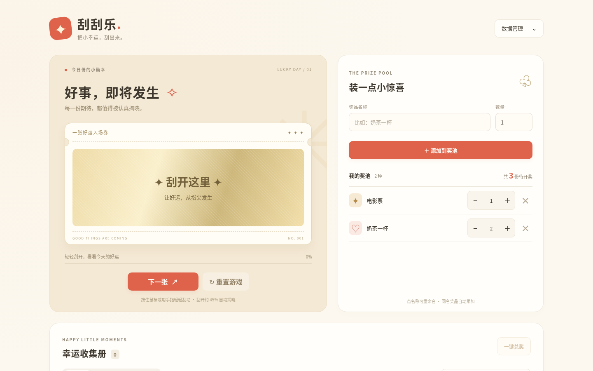
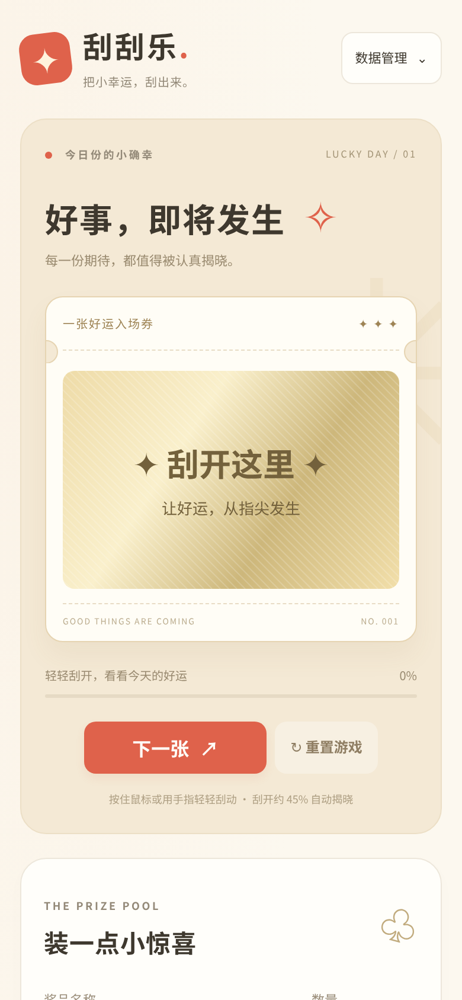

# 刮刮乐

把小幸运，刮出来。一款从零编写的纯前端刮奖小游戏，奶油色底、珊瑚红按钮与金色刮层，适合聚会、课堂活动与日常的小奖励。署名：不二。

零构建、零运行时依赖，不加载远程字体、图片或脚本。桌面采用刮奖区与奖池双栏，手机采用单列布局，中奖记录自动改为卡片。

## 功能与使用

1. **添加奖品**：输入名称与正整数数量，点击添加或按回车；同名自动累加。奖池中用 − / ＋ 调整库存，数量框可直接编辑，失焦或回车保存，允许 0。点名称可重命名，回车或失焦保存，Esc 取消；重名会提示。删除需确认，历史记录保留原名称。
2. **刮奖**：用鼠标或手指拖动金色涂层，刮开约 45% 自动揭晓，也可聚焦刮奖区后按回车或空格。新卡按剩余数量加权选定奖品，只有揭晓才扣库存并创建记录。点击「下一张」开始新卡，未揭晓的卡片不会消耗奖品。最后一份揭晓时庆祝并提示「这是最后一份奖品」，点击「下一张」后进入独立空状态并禁用下一张；点「补充奖品」滚动到奖池并聚焦名称框。
3. **兑奖与筛选**：中奖记录显示序号、中奖时间、奖品与兑奖时间。用「全部 / 未兑奖 / 已兑奖」查看对应计数，输入关键字搜索奖品名称。「兑奖」处理单条；「一键兑奖」只处理当前状态与搜索条件下的未兑奖记录，执行前确认数量。
4. **备份数据**：右上角「数据管理」可导出 JSON、导入 JSON 或清空数据，三者均有确认对话框。导入先校验，确认后覆盖当前数据；导出文件名为 `guaguale2-backup-YYYYMMDD-HHmm.json`。重置游戏同样清空奖品与记录，执行前需确认。对话框支持取消、Esc 关闭和键盘焦点约束。

无障碍支持包括可见焦点、键盘操作、状态通知及减少动态效果偏好。所有奖品名称都以文本节点或输入框值渲染。

## 本地运行

在项目根目录执行：

```sh
python3 -m http.server 5173
```

也可使用已安装的 `npx serve`，或运行 `npm run serve`。浏览器访问本地服务的 5173 端口即可。应用使用 ES modules，需要 HTTP 服务；不支持直接双击以本地文件方式打开。

运行网页不需要安装 npm 依赖。只有端到端测试需要开发依赖。

## 测试

纯函数测试无须安装依赖：

```sh
node --test tests/
# 或
npm test
```

测试覆盖加权抽取边界、同名累加、数量校验、名称编辑、揭晓扣库存、历史独立、筛选搜索、批量兑奖与备份校验。测试通过数据 URL 加载同一份浏览器模块，兼容没有 package type 字段的配置。

端到端测试：

```sh
npm i
npm run e2e
```

`playwright-core` 不自带浏览器，请在外部环境准备 Chromium / Chrome。通过 `CHROME_PATH` 环境变量指定可执行文件；未设置时采用 Playwright 默认浏览器路径。脚本会自行启动 Node 静态服务器，使用随机端口和子路径，无需手动启动服务。测试包括真实鼠标刮奖、触屏 pointer 刮奖、库存编辑、兑奖与筛选、下载校验、取消清空、确认清空及导入恢复。

保存桌面与手机截图：

```sh
npm run e2e -- --screenshots docs/screenshots
```

桌面为 1440×900，手机为 390×844、像素比 2，普通截图等待 Toast 消失；揭晓截图约在揭晓后 300ms 捕捉彩带，记录区使用完整区块截图。截图输出到 `docs/screenshots/`，包含首页、刮奖中、揭晓、记录、空奖池与确认对话框。运行上述命令更新桌面截图，并生成四张 `mobile-01-home.png` 至 `mobile-04-records.png`；脚本需在可运行 Chrome 的环境执行：





教学视频截图序列（独立手机流程，从空数据开始）：

```sh
node tests/e2e/flow.mjs --tutorial docs/tutorial
```

使用 390×844、像素比 2、支持触摸的视口，固定随机种子。依次演示逐字添加奖品、增加库存、分段触屏刮奖、两次揭晓、兑奖筛选、数据菜单与导出确认（最后取消）。仅保存视口截图，从 `001.png` 连续编号；`shots.json` 中每项为 `{file, step, note, cursor: {x, y, scrollY}}`，坐标以 CSS 像素表示。点击与输入记录操作元素中心，刮奖记录手指当前位置，`scrollY` 是截图时页面滚动位置。普通帧等待布局和动画就位，揭晓后额外每隔约 150ms 捕捉三张庆祝画面。`--tutorial` 运行教学流程；回归流程及其桌面/手机截图单独使用 `--screenshots`。

## 部署到 GitHub Pages

将项目放入仓库，在 Pages 设置中选择目标分支及根目录作为发布来源即可，无需构建或打包。部署目录保留 `index.html` 和 `src/`；全部资源使用相对路径，支持仓库子路径。测试脚本也通过子路径访问以验证这一点。

## 数据说明

数据只存在本机、当前浏览器、当前站点的 localStorage 中，不发送到服务器，不跨设备同步。换浏览器、换域名、清除站点数据或使用隐私模式可能导致数据不可用，请主动导出备份。

存储键为 `guaguale2:v1`，schema 版本为 `1`，与备份共用以下结构：

```json
{
  "version": 1,
  "prizes": [{ "id": "p1", "name": "电影票", "count": 2 }],
  "records": [{ "id": "r1", "prize": "奶茶一杯", "time": 1790000000000, "redeemTime": null }]
}
```

数量是 0 至 1000000 的整数，奖品名称为 1 至 80 字。记录采用毫秒时间戳，显示为本地时间 `YYYY-MM-DD HH:mm`，未兑奖为 `null`。导入拒绝坏 JSON、不支持的版本、非法数量、重复标识、重名奖品与非法时间；本地损坏数据不会导致页面崩溃。存储受限时会提示导出备份。

## 文件结构

```text
index.html               页面结构
src/store.js             无 DOM 的数据与校验逻辑
src/scratch.js           高清 pointer canvas 刮奖组件
src/ui.js                安全渲染、对话框、toast 与彩带
src/main.js              页面事件、存储与游戏状态
src/styles.css           响应式布局与动效
tests/store.test.js       Node 纯函数测试
tests/ui.test.js          对话框时序与 Toast 回归测试
tests/e2e/flow.mjs        Playwright 完整流程与截图
tests/e2e/tutorial.mjs    手机教学截图与坐标清单
docs/screenshots/        运行端到端测试后生成截图
```

测试钩子 `window.__guaguale.state` 返回当前状态的副本，`window.__guaguale.revealNow()` 直接触发当前卡片揭晓，重复调用不会重复扣减。钩子只供自动测试使用，没有 UI 入口。
